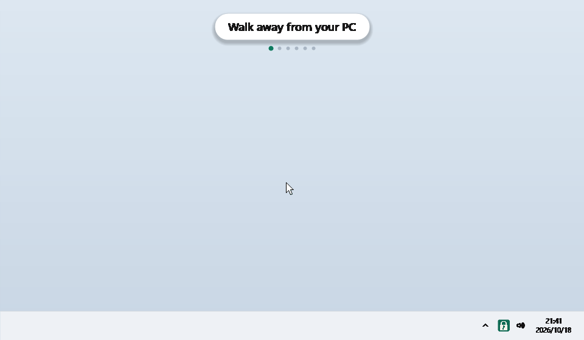
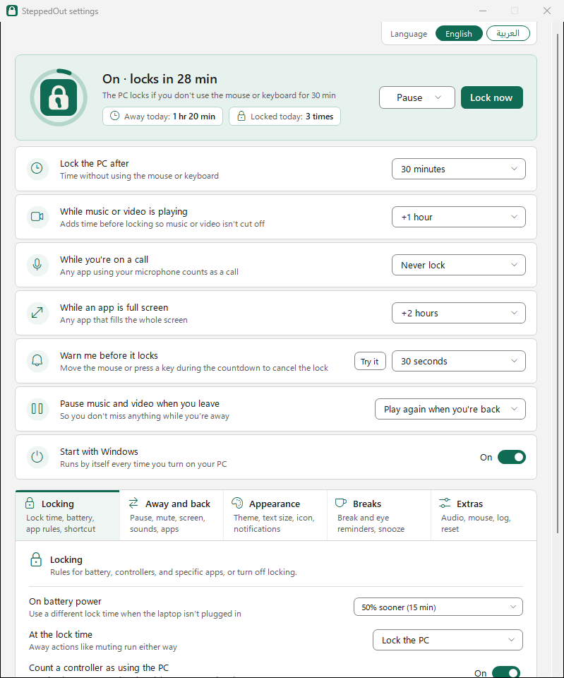

# SteppedOut


[](https://github.com/medric-z/steppedout/actions/workflows/build.yml)

**SteppedOut runs a routine when you get up from your PC, and another when you sit back down.**

It waits until you've really gone: no keyboard, mouse or controller for the time you pick, and
nothing that says you're still there, like music, a video, a call or a full-screen game. Then it
does what you set up for leaving. It can pause your music, mute the PC, close the apps you name,
open others, run your own script, and lock the PC, turn off the screen or put it to sleep. When you
come back it does the second half: it tells you how long you were away, plays your music again,
opens or closes apps and runs another script.

A countdown in the corner comes first, so a short pause never sets anything off. Downloads and
anything else you left running carry on. Everything stays on your PC: no account, nothing sent
anywhere.

**[Download it for Windows 10 and 11](https://github.com/medric-z/steppedout/releases/latest)**: one
file, nothing to install, no administrator rights.

<picture>
  <source media="(prefers-color-scheme: dark)" srcset="docs/shots/demo-en-dark.gif">
  
</picture>

## What it does

- Locks the PC after the time you choose with no keyboard, mouse or controller use. A countdown
  in the corner comes first, and moving the mouse or pressing a key cancels it.
- Keeps the PC unlocked, or waits longer, while music or video plays, an app is full screen, or you
  are on a call. The extra times add up.
- Gives the laptop on battery power its own lock time, sooner or a fixed latest time, and gives any
  app you name its own: sooner, later, a fixed time, or never.
- Does things when you leave and when you are back: pause music and video, mute the sound, turn off
  the screen, play a sound, open and close apps, run a script.
- Locks at once from the tray menu, or with a keyboard shortcut such as Ctrl+Alt+L once you turn
  one on. When it locks by itself, it can also turn off the screen or put the PC to sleep.
- Pauses for a set time, up to 7 days, or until you turn it back on.
- Reminds you to take a break, and to rest your eyes, if you turn that on.
- Looks light, dark or like Windows, with a choice of text size and of where its notes appear, in
  English or Arabic with a mirrored layout.
- Explains itself: a Why isn't the PC locking? window lists what is delaying the lock right now.
- Makes no network connections and sends nothing anywhere. See [Privacy](#privacy).

## Get started

1. Download `SteppedOut-win-x64.exe` from the
   [latest release](https://github.com/medric-z/steppedout/releases/latest). Take
   `SteppedOut-win-arm64.exe` instead only if Settings, System, About says "ARM-based processor".
   Put the file in any folder.
2. Open it from File Explorer rather than from the browser's list of downloads, since Close apps
   never closes the program SteppedOut was started from. A padlock appears next to the clock (if it
   is not there, click the ^ arrow beside the clock). A short welcome window takes you through five
   pages: what SteppedOut does; how long before it locks (5 minutes, 15 minutes, 30 minutes,
   1 hour, or Custom…), whether it warns you first, and a shortcut to lock at once (off unless you
   pick one); how much time to add while music or video plays, you are on a call or an app is full
   screen, and how much sooner to lock on battery (asked only on a PC with a battery); what to do
   when you leave and when you come back, and break reminders; and Start with Windows. A drawn PC and a timeline show what each choice does.
3. Click Done, or Open settings to finish and go straight to the settings window. Closing the window
   any other way counts as Done, and what you chose stands. "Start with Windows" is on by default in
   that window, so SteppedOut starts again each time you sign in; switch it off there, or later in
   the settings, if you would rather start it yourself.

Everything else is in the settings: click the padlock. To go through the welcome window again, use
Show the welcome again on the Extras tab. The ARM64 build comes out of CI and has not
been tested on an ARM PC yet.

### If Windows warns you

- **The browser says the file "isn't commonly downloaded".** In Edge, open the ... menu next to the
  download, choose Keep, then Show more and Keep anyway.
- **"Windows protected your PC" when you open it.** The file is not code-signed yet. Click More info,
  then Run anyway, or [check the download](#checking-the-download) first.
- **Smart App Control blocks it.** On a PC with Smart App Control switched on, which some new
  Windows 11 PCs have, Windows blocks unsigned programs it does not recognise and offers no "Run
  anyway". Until releases are signed, the only way past it is turning Smart App Control off in
  Windows Security, and that is hard to undo: before the April 2026 update it cannot be turned back
  on without resetting Windows, and since the October 2026 update (KB5127648) Microsoft lists a
  known issue where, on some PCs, the switch stays greyed out once it is off. If you are not sure,
  wait for a signed release.

### Install or update from PowerShell

```
irm https://raw.githubusercontent.com/medric-z/steppedout/main/install.ps1 | iex
```

This runs [install.ps1](install.ps1), which is short enough to read first. It downloads the latest
exe for your processor into `%LOCALAPPDATA%\SteppedOut` and checks it against the release's SHA256
list. If the list is missing, does not name the file or does not match, nothing is installed and
the copy you have keeps running. Then it stops the SteppedOut that is running in your sign-in,
whichever folder it was started from (a hand-downloaded one too, but only a file that says it is
SteppedOut, never another program whose name starts the same) and starts the new one. Run the same
line again to update. The installer leaves "Start with Windows" on or off as it was, but the first
start of 1.0 asks again in its welcome window (see below). Run from an admin PowerShell, it still
starts SteppedOut without admin rights.

### Coming from an earlier version

Version 1.0 starts fresh: none of the settings from an earlier version is carried over. The first
time 1.0 starts, it keeps the old `config.json` next to it as `config.json.before-1.0`, writes a new
one with the defaults, and opens the welcome window so you can make your choices again. The log says
so in one line. Only the copy that runs in the tray does this: `--once`, `--help` and a second start
leave the old file exactly as it is. If the old file cannot be kept, it is not replaced either; that
run uses the defaults and the next start tries again.

The welcome window asks about Start with Windows again, switched on, whatever it was before: switch
it off there if you would rather start SteppedOut yourself.

To go back to the old version, quit SteppedOut, copy `config.json.before-1.0` over `config.json`,
then start the old version. Version 0.1.0 is on its
[release page](https://github.com/medric-z/steppedout/releases/tag/v0.1.0). Starting 1.0 again
later starts fresh again. The section [Files from before 1.0](docs/advanced.md#files-from-before-10) has the details.

## Using it

The **[user guide](docs/guide.md)** walks through everything: the padlock and its menu, the settings window tab by tab, the countdown, what happens when you leave and come back, break reminders, the lock shortcut, game controllers, and what to check when the PC isn't locking.

<picture>
  <source media="(prefers-color-scheme: dark)" srcset="docs/shots/settings-en-dark.png">
  
</picture>

## Uninstall

The quickest way: on the Extras tab, click Remove… beside Remove SteppedOut's files, then Remove and
quit. That turns off Start with Windows, quits SteppedOut and deletes its files; then delete the
exe. A settings file you saved with Save to file… stays where you saved it.

Or by hand:

1. Click the padlock and switch "Start with Windows" off. If it already reads off, switch it on, wait
   a second, and switch it off again. That also clears a leftover entry in Task Manager's Startup
   apps.
2. Right-click the padlock and choose Quit SteppedOut.
3. Delete the exe (or, if you used the PowerShell line, the folder `%LOCALAPPDATA%\SteppedOut`) and
   your settings folder `%APPDATA%\SteppedOut`. That removes everything SteppedOut saved; see
   [Privacy](#privacy).

If you installed the Store version, uninstall it from Settings, Apps. Windows removes the files the
app created with it. A `config.json` that was already in `%APPDATA%\SteppedOut` before the Store
version first ran is used where it is, so it stays; delete that folder yourself if you want it gone.
[Privacy](#privacy) has the details.

## Why not use Windows' own lock?

Windows can lock a session on its own in a few ways.

| Method | Where | What it costs |
| --- | --- | --- |
| Screen saver with "On resume, display logon screen" | Screen saver settings | Fires on input silence alone. No warning; nothing holds it off. |
| "Interactive logon: Machine inactivity limit" | Local Security Policy (Home editions have no policy editor; the registry value behind it can be set by hand) | Administrator rights, a restart, and a screen saver should be active. Input silence alone. |
| Sign in again "When PC wakes up from sleep" | Settings, Accounts, Sign-in options | Only locks when the PC comes back from sleep. A machine that never sleeps never locks. |
| Dynamic lock | Settings, Accounts, Sign-in options | Needs a Bluetooth-paired phone. Reacts to the phone leaving, not to you. |
| Presence sensing ("lock on leave") | Settings, System, Power & battery, on devices that have the sensor | Needs a human-presence sensor, built in or plugged in by USB; most desktops and many laptops have none. Reacts to the sensor; a video, a call or another app keeping the screen on holds it off. |

The screen saver and the inactivity limit go only by the time since the last key press or mouse
movement, and that is not the same as you being away. A video with nobody typing looks like an empty
chair, and a mouse with a twitchy sensor looks like someone still sitting there. The sleep option
only locks when the PC actually goes to sleep, so a PC that stays awake never locks. None of these
three warns before locking or shows how much time is left, and none can be told "not while the
render is running".

SteppedOut watches the same clock and adds judgment: a countdown you can cancel, rules that add time
or keep it unlocked while something is actually happening, and a filter for mouse sensors that never
quite sit still. It can also pause what you were playing, mute, or turn the screens off while you are
gone, and it can do that tidying-up without locking at all if that is all you want. It needs no
administrator rights and makes no network connections. [What it never does](#what-it-never-does)
lists exactly what it touches.

## What it never does

- No network connections of any kind: no telemetry, no update check.
- No keyboard hook, no raw input, no clipboard. The lock shortcut is `RegisterHotKey`, which Windows
  answers only for that one combination, and the game controller is read by asking Windows for each
  controller's state (XInput polling). The log never contains window titles or anything you type.
- No administrator rights. The manifest asks for none.
- Files only in `%APPDATA%\SteppedOut`, listed under [Privacy](#privacy), and a copy of the settings
  where you choose when you use Save to file…. The Store version keeps the files it creates in its
  own package folder instead.
- Registry writes: only its own `SteppedOut` value under
  `HKCU\Software\Microsoft\Windows\CurrentVersion\Run`. Whenever it sets that value, it also removes
  the off mark Task Manager's Startup apps page may keep for it (under
  `Explorer\StartupApproved\Run`), so turning it on really turns it on. An entry turned off in Task
  Manager shows as off in the settings. If the value points at a copy that was moved or deleted, the
  running copy rewrites it to point at itself when it starts, with no click, and keeps any options
  after the path, unless you turned the entry off in Task Manager. A run with `--dry-run` never does
  this, or changes Start with Windows in any other way; it only logs what it would do. The Store
  version has no Run value: it uses the package's own startup task.
- It closes and opens only the apps you list, and runs only the scripts you choose.

## Privacy

SteppedOut collects nothing and makes no network connections. It has no account, no telemetry, no
analytics and no update check, and it sends nothing anywhere. What it knows about you stays on your
PC.

It saves these files, all in `%APPDATA%\SteppedOut`, and writes no others, apart from a copy of the
settings that Save to file… writes where you choose:

| File | What it holds | When it exists |
| --- | --- | --- |
| `config.json` | Your settings, including the paths or names of apps and scripts you chose. | Always. Only the copy that runs in the tray makes it, with the defaults, the first time; `--once` and a second start never do. |
| `config.json.before-1.0` | The settings file of a version before 1.0, kept exactly as it was when 1.0 replaced it with a fresh one. Version 1.0 never reads it. | Only if you used an older version. If that name is taken by a different file or a folder, as after going back to the old version and using it, the new copy is `config.json.before-1.0.<yyyyMMdd-HHmm>` (date and time), then the same with `-2`, `-3` and so on up to `-99`; none is overwritten, and the same file is never kept twice. |
| `~config.json.tmp` | A settings file being saved. Each save writes it first and then moves it over `config.json`, so a crash or a full disk never leaves a half-written settings file. A copy kept as `config.json.before-1.0` is made the same way, through `~config.json.before-1.0.tmp` (or the name with the date and time). A `config.json` with more than one name (a hard link) is written in place instead, since a new file moved over it would leave its other names with the old settings, and so is the Store version's `config.json` when it is only in the real `%APPDATA%\SteppedOut`; neither uses a temporary file. A symbolic link is followed to the file it leads to, which is saved as any other, with the temporary file next to it; the link stays. | Only for a moment while saving. One left behind by a crash or a power cut is written over by the next save. |
| `config.json.broken` | A settings file that did not load, set aside the next time the settings are saved. | Only after a mistake in a hand-edited file. |
| `SteppedOut.log` and `SteppedOut.old.log` | What SteppedOut did and why: locks, pauses, the lock time and what changed it, the names of programs that played sound, were full screen or used the microphone, and the names or paths of the programs and scripts it paused, closed, opened or started. Each time it starts it also writes a line with the version, the build it came from and the path of the settings file, which contains your Windows user name. Never window titles or anything you type. One older generation is kept. | Always, except for `--once`, which writes no log; capped at 512 KB by default (Log size, on the Extras tab). |
| `today.json` | Today's date, how many times the PC locked and how long you were away, for the Locked today and Away today boxes. It is overwritten in place, never grows, and starts again each day. | Always; written within a minute of the first start, updated while it runs and saved when you quit. It stays on disk afterwards, and a restart on the same day carries on from it. |
| `muted-by-SteppedOut` | The Windows identifier of the sound device it muted, so a restart cannot leave it muted. | Only while the sound is muted. |

The only other thing it changes is in the registry. It sets its `SteppedOut` value under
`HKCU\Software\Microsoft\Windows\CurrentVersion\Run` when Start with Windows is turned on and
removes it when it is turned off. Turning it on also removes the off mark Task Manager's Startup
apps page may keep for it, under `Explorer\StartupApproved\Run`. If the value points at a copy that
was moved or deleted, the running copy rewrites it to point at itself when it starts, with no click
and keeping any options after the path, unless you turned the entry off in Task Manager. A run with
`--dry-run` never changes it; it only logs what it would do.

To apply your rules it looks at what is going on: which programs run, which windows are on screen,
which programs make sound or use the microphone, whether a video asked to keep the display on, and
whether the laptop is on battery. That is read as it is needed and kept in memory. The only trace is
the program names in the log, as listed above.

To delete everything, use Remove SteppedOut's files on the Extras tab and then delete the exe, or
switch Start with Windows off, quit SteppedOut, and delete the folder `%APPDATA%\SteppedOut` and the
exe. Nothing else is left. The [Uninstall](#uninstall) section has
the steps.

The Microsoft Store version behaves the same way: it makes no network connections and collects
nothing. It differs in two things. The first is where Windows keeps its files. A file that is
already in `%APPDATA%\SteppedOut`, such as the `config.json` of an earlier SteppedOut, is used where
it is, and later saves are written into that same file. The files the Store version creates itself go
to the app's own folder,
`%LOCALAPPDATA%\Packages\<package family name>\LocalCache\Roaming\SteppedOut`, and Windows removes
them when the app is uninstalled. That includes `config.json.before-1.0`, the copy it keeps of an
earlier version's `config.json`: it is in the app's own folder, not the one Open folder opens, and it
goes when the app is uninstalled, so copy it somewhere else first if you want to go back to 0.1.0.
Anything that was already in `%APPDATA%\SteppedOut` stays; delete that folder yourself if you want it
gone. Open folder on the Extras tab opens the folder that holds `config.json`. The second is that Start
with Windows is the package's startup task instead of a registry value, which Settings, Apps,
Startup also shows.

To ask a question about privacy, or to report a mistake on this page, open an issue at
[github.com/medric-z/steppedout/issues](https://github.com/medric-z/steppedout/issues). If this
policy changes, the change is made in this section, the file's history on GitHub shows what changed
and when, and the release notes of the version it comes with say that it changed.

## For advanced users

**[For advanced users](docs/advanced.md)** covers the command-line options, every key in the settings file, the log, and why the file is about 100 MB.

## How it works

**[How it works](docs/how-it-works.md)** explains how SteppedOut decides you have gone: the idle clock, the filter for tiny mouse movements, how the rules add up to a lock time, what runs while you are away, the reminder timers and the lock itself.

## Checking the download

Every release is built by `.github/workflows/release.yml` and carries a build provenance
attestation. With the [GitHub CLI](https://cli.github.com/):

```
gh attestation verify SteppedOut-win-x64.exe --repo medric-z/steppedout
```

That confirms the file was built by GitHub Actions in this repository, and the output names the
workflow (`release.yml`) and the tag it was built from. Without the GitHub CLI, open PowerShell in
the download folder and compare the result with the line for your file in `SHA256SUMS.txt` on the
release page:

```
Get-FileHash .\SteppedOut-win-x64.exe
```

Or build it yourself.

## Building from source

Needs the [.NET 10 SDK](https://dotnet.microsoft.com/download).

```
dotnet build src/SteppedOut.csproj -c Release
dotnet test tests/SteppedOut.Tests.csproj
dotnet publish src/SteppedOut.csproj -c Release -r win-x64 -o publish
```

The publish step produces one self-contained exe. Add `--no-self-contained` for an exe of about
1 MB that needs the .NET Desktop Runtime installed instead.

[docs/layout.md](docs/layout.md) lists which file holds each feature and the one line that switches
it on, so a feature can be read, changed or taken out on its own.

## Code signing policy

Releases are built by GitHub Actions from the tagged commit; nothing is built on a developer's
machine. They are not signed with a certificate yet. The plan is to apply to the SignPath Foundation
for free open-source code signing; if it is granted, every release will carry the line "Free code
signing provided by [SignPath.io](https://signpath.io), certificate by
[SignPath Foundation](https://signpath.org)".

- Committers and reviewers: [medric-z](https://github.com/medric-z)
- Approvers: [medric-z](https://github.com/medric-z)

Privacy: this program will not transfer any information to other networked systems unless
specifically requested by the user or the person installing or operating it.

## Licence

MIT. See [LICENSE](LICENSE).
